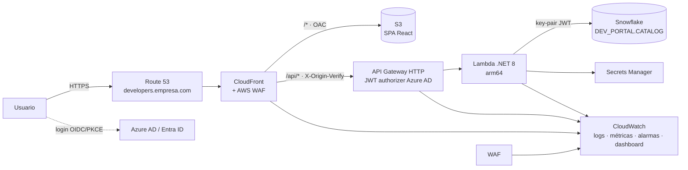

# Developer Portal

Portal interno de documentación de APIs (inspirado en el estilo de *docs.cobre.com*) con **filtro por tecnología** (.NET, MuleSoft, Java, Node.js, …), autenticación con **Azure AD (Entra ID)** y catálogo almacenado en **Snowflake**.

## Arquitectura



| Capa | Tecnología | Detalle |
|---|---|---|
| Frontend | React 18 + Vite + TypeScript | SPA estática en S3, MSAL (Azure AD) con PKCE, filtros en la URL (`?tech=dotnet,mulesoft&q=pagos`) |
| CDN / Edge | CloudFront + WAF + Route 53 + ACM | OAC hacia S3, `/api/*` hacia API Gateway, cabeceras de seguridad (CSP, HSTS), WAF con reglas administradas de AWS + rate limit + geo opcional |
| API | API Gateway HTTP API + Lambda .NET 8 (ASP.NET Core minimal API) | Doble validación del JWT (authorizer en API Gateway y `JwtBearer` en la Lambda), rol `Portal.Admin` para escribir |
| Datos | Snowflake | Usuario de servicio con **key-pair**, credenciales en Secrets Manager, consultas 100 % parametrizadas |
| Observabilidad | CloudWatch | Logs JSON, métricas EMF (`SnowflakeQueryDuration`, `UnhandledErrors`), X-Ray, alarmas → SNS (correo), dashboard |
| IaC / CI-CD | Terraform + Azure DevOps | Stages Build → DEV → PRD (aprobación manual) |

### Seguridad en capas

1. **WAF** (us-east-1, scope CLOUDFRONT): `AmazonIpReputationList`, `CommonRuleSet`, `KnownBadInputs`, límite por IP, allow-list de países opcional. Los logs ocultan el header `Authorization`.
2. **CloudFront** solo sirve HTTPS (TLS 1.2+), el bucket S3 es privado (solo OAC) y la API rechaza con 403 cualquier petición sin el header secreto `X-Origin-Verify`, así que no se puede llamar directamente a API Gateway saltándose el WAF.
3. **API Gateway** valida el token de Azure AD (emisor, audiencia, firma y expiración) antes de invocar la Lambda.
4. **Lambda** vuelve a validar el token y aplica autorización por *app role* (`Portal.Admin` para crear, editar o eliminar).
5. **Snowflake**: rol de mínimo privilegio (`PORTAL_APP`), sin password, consultas parametrizadas y búsqueda con `ILIKE … ESCAPE`.

## Estructura del repositorio

```
frontend/            SPA React (Vite) – catálogo, detalle de API, panel de administración
backend/             Lambda .NET 8 (ASP.NET Core) + pruebas xUnit
database/            Scripts de Snowflake: setup (rol, usuario, warehouse), esquema y datos de ejemplo
infra/terraform/     S3, CloudFront, Route 53, ACM, WAF, API Gateway, Lambda, Secrets Manager, CloudWatch
pipelines/           Plantillas de Azure DevOps
azure-pipelines.yml  Pipeline principal
```

## API

| Método | Ruta | Rol | Descripción |
|---|---|---|---|
| GET | `/api/health` | anónimo | Health check |
| GET | `/api/technologies` | autenticado | Tecnologías con el conteo de APIs |
| GET | `/api/apis?technology=dotnet,mulesoft&q=texto&category=Pagos` | autenticado | Catálogo filtrado |
| GET | `/api/apis/{slug}` | autenticado | Detalle con endpoints y ejemplos |
| POST | `/api/apis` | `Portal.Admin` | Crear API |
| PUT | `/api/apis/{slug}` | `Portal.Admin` | Actualizar API |
| DELETE | `/api/apis/{slug}` | `Portal.Admin` | Eliminar API |

## Puesta en marcha

### 1. Azure AD (Entra ID)

Se usa **una sola App Registration** para el SPA y la API:

1. *App registrations → New registration* → nombre `Developer Portal`, cuentas solo de este tenant.
2. *Authentication → Add a platform → Single-page application*, redirect URIs:
   `https://developers.empresa.com`, `https://developers-dev.empresa.com`, `http://localhost:5173`.
3. *Expose an API*: Application ID URI `api://<client-id>` y scope `Portal.Read`.
4. *App roles*: crea `Portal.Admin` (Allowed member types: Users/Groups).
5. *Manifest*: `"accessTokenAcceptedVersion": 2` (el authorizer de API Gateway valida el emisor v2).
6. *Enterprise applications → Developer Portal → Users and groups*: asigna el rol `Portal.Admin` al grupo de administradores. Si quieres que **solo** ciertos grupos entren al portal, activa *Assignment required = Yes* y asígnales acceso.

Valores resultantes: `AZURE_TENANT_ID`, `AZURE_CLIENT_ID`, `AZURE_API_SCOPE = api://<client-id>/Portal.Read`.

### 2. Snowflake

```bash
# Llaves del usuario de servicio
openssl genrsa 2048 | openssl pkcs8 -topk8 -inform PEM -out rsa_key.p8 -nocrypt
openssl rsa -in rsa_key.p8 -pubout -out rsa_key.pub
```

Ejecuta en orden `database/01_setup.sql` (pega la llave pública), `02_schema.sql` y `03_seed.sql`.

Para agregar una tecnología nueva al filtro solo hay que insertar una fila en `TECHNOLOGIES`:

```sql
INSERT INTO DEV_PORTAL.CATALOG.TECHNOLOGIES (SLUG, NAME, COLOR, SORT_ORDER) VALUES ('go', 'Go', '#00add8', 60);
```

### 3. Infraestructura (Terraform)

Requisitos previos: zona de Route 53 creada y un bucket S3 + tabla DynamoDB para el state.

```bash
cd backend && dotnet publish src/DeveloperPortal.Api -c Release -r linux-arm64 --self-contained false -o artifacts/publish \
  && (cd artifacts/publish && zip -qr ../lambda.zip .)

cd ../infra/terraform
terraform init -backend-config=environments/backend-dev.hcl
terraform apply -var-file=environments/dev.tfvars
```

Carga **una sola vez** el secreto de Snowflake. Se hace fuera de Terraform para que la llave privada no quede en el state:

```bash
aws secretsmanager put-secret-value --secret-id "$(terraform output -raw snowflake_secret_arn)" --secret-string "$(jq -n \
  --arg pk "$(cat rsa_key.p8)" \
  '{account:"<org>-<cuenta>", user:"SVC_DEV_PORTAL", privateKey:$pk, warehouse:"PORTAL_WH",
    database:"DEV_PORTAL", schema:"CATALOG", role:"PORTAL_APP"}')"
```

Confirma la suscripción de correo de SNS para recibir las alarmas.

### 4. Azure DevOps

1. Instala la extensión **AWS Toolkit for Azure DevOps** y crea las service connections `aws-devportal-dev` y `aws-devportal-prd`, idealmente con OIDC o un rol con *assume role*.
2. Crea los variable groups `devportal-dev` y `devportal-prd` con:
   `AZURE_TENANT_ID`, `AZURE_CLIENT_ID`, `AZURE_API_SCOPE`, `ADMIN_ROLE`, `TF_STATE_BUCKET`, `TF_LOCK_TABLE`, `AWS_REGION`.
3. Crea los environments `devportal-dev` y `devportal-prd`, y agrega aprobadores al de PRD.
4. Crea el pipeline apuntando a `azure-pipelines.yml`.

## Desarrollo local

```bash
# Frontend con datos de ejemplo (sin Azure AD ni backend)
cd frontend && cp .env.example .env.local && npm install && npm run dev   # http://localhost:5173

# Backend contra Snowflake real (autenticación de desarrollo, usuario admin ficticio)
cd backend/src/DeveloperPortal.Api
# edita appsettings.Development.json -> Snowflake:ConnectionString (private_key_file=...)
ASPNETCORE_ENVIRONMENT=Development dotnet run --urls http://localhost:5000
# y en frontend/.env.local: VITE_USE_MOCKS=false (requiere Azure AD configurado)
```

Pruebas:

```bash
cd frontend && npm test          # Vitest
cd backend && dotnet test        # xUnit
cd infra/terraform && terraform fmt -check && terraform validate
```

## Monitoreo

- **Dashboard** `devportal-<env>-portal`: invocaciones, errores y duración de la Lambda, latencia de Snowflake por operación, 4xx/5xx de API Gateway, CloudFront y WAF, y los últimos errores (Logs Insights).
- **Alarmas** (SNS → correo): errores y throttles de la Lambda, 5xx y latencia de API Gateway, `UnhandledErrors`, tasa de 5xx de CloudFront y pico de bloqueos del WAF.
- **Logs**: `/aws/lambda/devportal-<env>-api` (JSON), `/aws/apigateway/devportal-<env>-api` (acceso, incluye el usuario), `aws-waf-logs-devportal-<env>` (us-east-1).
